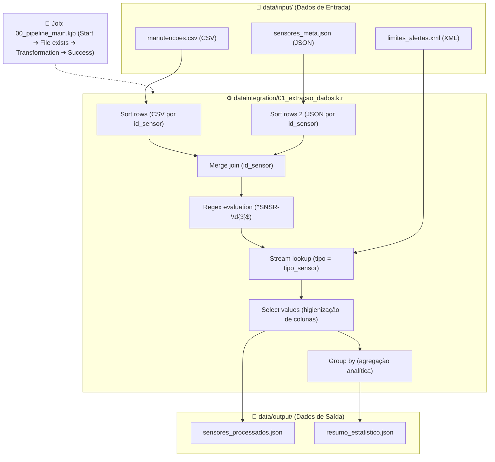

# 🏙️ Smart City IoT ETL Pipeline | Pentaho Data Integration (PDI)

[](#-identificação-do-autor--trabalho)
[](#-identificação-do-autor--trabalho)
[](https://www.hitachivantara.com/)
[](https://youtu.be/g8CUr558Yjk)
[](#-licença)

---

## 👨‍🎓 Identificação do Autor & Trabalho

| Campo | Detalhe |
| :--- | :--- |
| **Autor:** | **Lucas Lima Magalhães** |
| **Número de Aluno:** | **51233** |
| **Email:** | `lukeskywalker.lm04@gmail.com` |
| **Instituição:** | Instituto Politécnico do Cávado e do Ave (IPCA) |
| **Curso:** | Licenciatura em Engenharia de Sistemas Informáticos (LESI) |
| **Unidade Curricular:** | Integração de Sistemas de Informação (ISI) |
| **Ano Letivo:** | 2026/2027 |
| **Docentes:** | Prof. Luís Ferreira & Prof. Óscar Ribeiro |
| **Repositório Git:** | [https://github.com/LucasMagalhaes-sys/TP01](https://github.com/LucasMagalhaes-sys/TP01) |

---

## 🎬 Vídeo de Demonstração (Requisito Obrigatório)

> [!IMPORTANT]
> **Link direto para o vídeo de demonstração do projeto:**
> 🔗 **[https://youtu.be/g8CUr558Yjk](https://youtu.be/g8CUr558Yjk)**
>
> O vídeo apresenta a explicação da arquitetura, a abertura dos artefactos no Pentaho Spoon, a inspeção de cada step do pipeline e a validação em tempo real da execução com a geração dos ficheiros de saída.

---

## 🎯 Enquadramento & Objetivos do Projeto

Este projeto consiste na conceção e implementação de um pipeline de **ETL (*Extract, Transform, Load*)** totalmente funcional, orquestrado e automatizado na ferramenta **Pentaho Data Integration (PDI / Kettle Spoon)**.

O cenário aborda a recolha, tratamento e harmonização de dados telemétricos heterogéneos num contexto de **Smart Cities (Cidades Inteligentes)**, unificando métricas de monitorização ambiental (Qualidade do Ar) e mobilidade urbana (Tráfego).

### Principais Objetivos Técnicos:
- **Ingestão Multiformato:** Extração e consumo simultâneo de fontes estruturadas e semiestruturadas nos formatos **CSV**, **JSON** e **XML**.
- **Validação com Expressões Regulares:** Sanitização e auditoria de integridade do identificador dos sensores através de **Regex** (`^SNSR-\d{3}$`).
- **Enriquecimento & Cruzamento:** Combinação em memória por chave primária (*Merge Join* ordenado) e associação dinâmica de parâmetros de limiares críticos (*Stream Lookup*).
- **Sumarização Analítica:** Agregação estatística (*Group By*) apurando o total de dispositivos por tipologia e a média ponderada dos limiares de alerta.
- **Orquestração Automatizada:** Criação de um **Job Kettle (.kjb)** com controlo de pré-condições (*File exists*), invocação dinâmica de transformação (*Transformation*) e sinalização de sucesso.

---

## 📁 Descrição dos Ficheiros Enviados

O repositório e pacote de submissão encontram-se estruturados de forma modular e padronizada, divididos nas seguintes diretorias:

```text
TP01-51233/
├── data/
│   ├── input/
│   │   ├── limites_alertas.xml       # Regras de negócio com os limiares máximos por tipo de sensor (XML)
│   │   ├── manutencoes.csv           # Histórico operacional das revisões técnicas e estados (CSV)
│   │   └── sensores_meta.json        # Metadados e geolocalização dos sensores urbanos (JSON)
│   └── output/
│       ├── resumo_estatistico.json   # Dataset analítico agregado com métricas consolidadas (JSON)
│       └── sensores_processados.json # Dataset granular completo enriquecido e higienizado (JSON)
├── dataintegration/
│   ├── 00_pipeline_main.kjb          # Job Kettle de orquestração, controlo de fluxo e execução sequencial
│   └── 01_extracao_dados.ktr         # Transformação Kettle contendo a lógica de ETL completa
├── doc/
│   ├── 51233_doc.pdf                 # Relatório técnico formal com a fundamentação do projeto
│   └── 512333_doc.pdf                # Cópia complementar do relatório técnico
└── README.md                         # Documentação principal, identificação, vídeo e instruções
```

### Detalhe dos Ficheiros e Responsabilidades:

#### 1. Diretoria `dataintegration/` (Artefactos Pentaho Kettle)
- **`00_pipeline_main.kjb` (Kettle Job):**
  - Orquestrador principal do ciclo de vida da integração.
  - Sequência de execução: `Start` ➔ `File exists` (assegura a existência do ficheiro `data/input/manutencoes.csv`) ➔ `Transformation` (chama dinamicamente `01_extracao_dados.ktr` através da variável de sistema `${Internal.Entry.Current.Directory}`) ➔ `Success`.
- **`01_extracao_dados.ktr` (Kettle Transformation):**
  - Implementa as 3 fases clássicas do processo de ETL (Extração, Transformação e Carga).
  - Inclui leitura paralela de 3 formatos distintos, pré-ordenação, emparelhamento em memória, validação por Regex, lookup de metadados, formatação e agregação analítica.

#### 2. Diretoria `data/input/` (Fontes Heterogéneas de Entrada)
- **`manutencoes.csv` (CSV):** Registo operacional de auditorias técnicas contendo os campos: `id_manutencao`, `id_sensor`, `data_revisao`, `estado` e `tecnico`.
- **`sensores_meta.json` (JSON):** Metadados e localização das estações de recolha IoT urbana contendo os campos: `id_sensor`, `localizacao`, `tipo` e `data_instalacao`.
- **`limites_alertas.xml` (XML):** Tabela de parametrização e regras de negócio contendo: `tipo_sensor`, `metrica` e `limite_maximo`.

#### 3. Diretoria `data/output/` (Datasets Finais de Saída)
- **`sensores_processados.json`:** Dataset granular final com cada registo de sensor combinado, enriquecido com a indicação de formato válido (`formato_sensor_valido: true/false`) e limiar crítico atribuído.
- **`resumo_estatistico.json`:** Dataset resumido com indicadores agregados (`total_sensores` calculados via `COUNT_ALL` e `media_limite_alerta` calculada via `AVERAGE` por tipo de sensor).

#### 4. Diretoria `doc/` (Documentação Académica)
- **`51233_doc.pdf`:** Relatório formal elaborado de acordo com os requisitos pedagógicos da unidade curricular, cobrindo introdução, enquadramento, arquitetura da solução, passos do ETL, evidências de execução e conclusões.

---

## 📐 Arquitetura do Pipeline ETL



---

## 🚀 Como Executar o Projeto no Pentaho Spoon (Passo a Passo)

### Pré-requisitos
1. **Java Runtime Environment (JRE) / JDK 8 ou 11:**
   - O Pentaho Data Integration requer o Java configurado nas variáveis de ambiente (`JAVA_HOME` e `PATH`).
   - Para verificar no terminal:
     ```bash
     java -version
     ```
2. **Pentaho Data Integration (PDI / Spoon):**
   - Versão recomendada: **PDI 9.x** ou **PDI 10.x**.

---

### Passo 1: Abrir o Pentaho Spoon
1. Navegue até à pasta onde se encontra descompactado o Pentaho Data Integration (pasta `data-integration/`).
2. Execute o ficheiro de arranque do Spoon de acordo com o seu sistema operativo:
   - **No Windows:** dê duplo clique em `spoon.bat` ou execute via PowerShell/CMD.
   - **No Linux / macOS:** execute no terminal `./spoon.sh`.
3. Aguarde o arranque da interface gráfica do Spoon.

---

### Passo 2: Abrir o Job Principal de Orquestração
1. Na barra de ferramentas superior do Spoon, clique em **`File` ➔ `Open`** (ou utilize o atalho `Ctrl + O`).
2. Navegue até à diretoria do projeto descompactado e aceda à pasta **`dataintegration/`**.
3. Selecione e abra o ficheiro:
   ```text
   dataintegration/00_pipeline_main.kjb
   ```
4. O diagrama do Job será carregado na área de trabalho, exibindo os steps `Start`, `File exists`, `Transformation` e `Success`.

---

### Passo 3: Executar o Job no Spoon
1. No canto superior esquerdo do painel do Job, clique no botão verde **Run / Play ▶** (ou prima `F8`).
2. Na janela modal de configuração de execução (*Execute a job*), mantenha as opções por defeito (*Local execution*) e clique em **Launch**.
3. Acompanhe a execução no separador inferior **Execution Results / Job History**:
   - Cada etapa exibirá um visto verde (ícone de sucesso).
   - O step `File exists` valida a presença do ficheiro de entrada `data/input/manutencoes.csv`.
   - O step `Transformation` dispara automaticamente o ficheiro `01_extracao_dados.ktr`.
   - O step `Success` confirma a finalização correta de todo o pipeline.

---

### Passo 4: Executar e Inspecionar a Transformação (Opcional / Debug)
Caso pretenda inspecionar o fluxo de dados em cada step individual:
1. No menu do Spoon, clique em **`File` ➔ `Open`** e selecione:
   ```text
   dataintegration/01_extracao_dados.ktr
   ```
2. Clique no botão **Run / Play ▶** (ou `F8`) e selecione **Launch**.
3. Na aba inferior **Step Metrics**, verifique a contagem de linhas lidas (*Lines read*), processadas (*Lines written*) e eventuais erros.
4. Para auditar os dados em trânsito, clique com o botão direito em qualquer step (por exemplo, `Select values` ou `Group by`) e selecione **Preview** ou consulte o separador **Execution Results ➔ Preview data**.

---

### Passo 5: Validação dos Ficheiros Gerados
Após a execução, confirme a criação e integridade dos ficheiros resultantes na pasta `data/output/`:
- **`data/output/sensores_processados.json`:** registos enriquecidos com chave de validação Regex `formato_sensor_valido` e limiar máximo associado.
- **`data/output/resumo_estatistico.json`:** agregação analítica com as contagens e médias agrupadas por tipologia.

> [!TIP]
> **Portabilidade Garantida:** Todos os caminhos de ficheiros de entrada e saída nos artefactos `.kjb` e `.ktr` foram configurados utilizando a variável `${Internal.Entry.Current.Directory}/../data/...`. Desta forma, o projeto pode ser executado em qualquer computador ou diretoria sem necessidade de reconfiguração de caminhos absolutos.

---

## 📄 Licença

Este projeto foi desenvolvido estritamente para efeitos académicos no âmbito da unidade curricular de **Integração de Sistemas de Informação (ISI)** da **LESI - IPCA (2026/2027)**.
Distribuído sob a licença [MIT](https://opensource.org/licenses/MIT).
