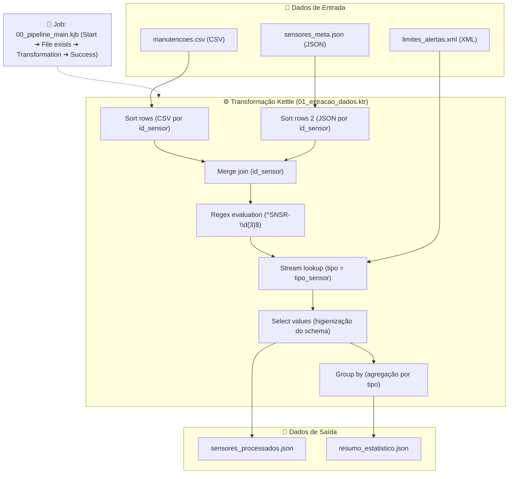

# 🏙️ Smart City IoT ETL Pipeline | Pentaho Data Integration (PDI)

[](https://www.hitachivantara.com/)
[](#-licença)
[](https://github.com/LucasMagalhaes-sys/TP01)

Pipeline de ETL (*Extract, Transform, Load*) automatizado e robusto desenvolvido no **Pentaho Data Integration (PDI / Spoon)** para ingestão, harmonização e agregação de dados heterogéneos de sensores IoT urbanos (Qualidade do Ar e Tráfego).

> **Contexto:** Trabalho desenvolvido no âmbito da unidade curricular de **Integração de Sistemas de Informação (ISI)** da Licenciatura em Engenharia de Sistemas Informáticos no **Instituto Politécnico do Cávado e do Ave (IPCA)**.

---

## 🎯 Objetivos do Projeto

- **Ingestão Multiformato:** Extração e unificação de fontes heterogéneas de dados nos formatos **CSV**, **JSON** e **XML**.
- **Validação & Limpeza de Dados:** Sanitização de esquemas e validação de nomenclatura dos identificadores de sensores utilizando **Expressões Regulares (Regex)**.
- **Enriquecimento & Cruzamento:** Combinação de fluxos em memória (*Merge Join* e *Stream Lookup*) com dados operacionais e regras de limiares.
- **Agregação Analítica:** Sumarização estatística (*Group By*) calculando totais de sensores operacionais e médias de limiares de alerta.
- **Orquestração Automatizada:** Criação de um **Job Kettle** que garante a verificação prévia de integridade e a execução sequencial controlada do fluxo.

---

## 📐 Arquitetura da Solução



---

## ⚙️ Detalhes do Pipeline

### 1. Extração ("E")

| Ficheiro de Entrada | Formato | Descrição | Campos Relevantes |
| :--- | :---: | :--- | :--- |
| `dados_entrada/manutencoes.csv` | CSV | Registo operacional das revisões técnicas | `id_manutencao`, `id_sensor`, `data_revisao`, `estado`, `tecnico` |
| `dados_entrada/sensores_meta.json` | JSON | Metadados e localização das estações de recolha | `id_sensor`, `localizacao`, `tipo`, `data_instalacao` |
| `dados_entrada/limites_alertas.xml` | XML | Regras de negócio com os limiares críticos | `tipo_sensor`, `metrica`, `limite_maximo` |

### 2. Transformação ("T")

* **`Sort rows` & `Sort rows 2`**: Pré-ordenação obrigatória dos fluxos CSV e JSON pelo atributo `id_sensor` para viabilizar o emparelhamento em memória.
* **`Merge join`**: Junção dos dados operacionais de manutenção com os metadados cadastrais do sensor correspondente.
* **`Regex evaluation`**: Auditoria de formato do identificador do sensor com o padrão `^SNSR-\d{3}$`, gerando a coluna de validação booleana `formato_sensor_valido`.
* **`Stream lookup`**: Cruzamento dinâmico com o XML de regras de negócio através da chave `tipo = tipo_sensor`, adicionando o limiar crítico (`limite_alerta`).
* **`Select values`**: Higienização, reordenação e filtragem de metadados para formatação final do registo.
* **`Group by`**: Cálculo em memória do total de sensores (`COUNT_ALL` ➔ `total_sensores`) e da média dos limiares de alerta (`AVERAGE` ➔ `media_limite_alerta`) agrupados por `tipo`.

### 3. Carga e Exportação ("L")

* **`dados_saida/sensores_processados.json`**: Dataset granular final consolidado, higienizado e validado.
* **`dados_saida/resumo_estatistico.json`**: Dataset analítico resumido com indicadores agregados para apoio à decisão.

### 4. Orquestração (Job Kettle)

O ficheiro `00_pipeline_main.kjb` controla o ciclo de vida da execução:
1. **`Start`**: Ponto de entrada do fluxo.
2. **`File exists`**: Validação de pré-requisitos para averiguar a existência do ficheiro de dados antes do disparo do processamento.
3. **`Transformation`**: Invocação da transformação `01_extracao_dados.ktr` com caminho dinâmico (`${Internal.Entry.Current.Directory}`).
4. **`Success`**: Conclusão bem-sucedida do pipeline.

---

## 📂 Estrutura do Repositório

```bash
.
├── dados_entrada/
│   ├── limites_alertas.xml       # Regras de negócio e limiares (XML)
│   ├── manutencoes.csv           # Histórico de revisões e técnicos (CSV)
│   └── sensores_meta.json        # Metadados e localização dos sensores (JSON)
├── dados_saida/
│   ├── resumo_estatistico.json   # Dataset com métricas e agregações
│   └── sensores_processados.json # Dataset granular consolidado
├── docs/
│   └── Relatorio_ISI_TP01.pdf    # Relatório formal do trabalho prático
├── etl_kettle/
│   ├── 00_pipeline_main.kjb      # Job Kettle de orquestração
│   └── 01_extracao_dados.ktr     # Transformação Kettle com a lógica ETL
└── README.md
```

---

## 🚀 Como Executar o Projeto

### Pré-requisitos

* **Java Runtime Environment (JRE) 8** ou superior instalado e configurado no `PATH` / `JAVA_HOME`.
* **Pentaho Data Integration (PDI / Spoon)** v9.x ou v10.x.

### Passo a Passo

1. **Clonar o Repositório:**
   ```bash
   git clone https://github.com/LucasMagalhaes-sys/TP01.git
   cd TP01
   ```

2. **Abrir o Pentaho Spoon:**
   * Inicie o **Spoon** (`spoon.bat` no Windows ou `spoon.sh` no Linux/macOS).

3. **Abrir e Executar o Job:**
   * No menu do Spoon, clique em `File` ➔ `Open` e selecione `etl_kettle/00_pipeline_main.kjb`.
   * Clique no botão **Run / Play ▶** para executar a orquestração.
   * Alternativamente, pode abrir e testar individualmente a transformação `etl_kettle/01_extracao_dados.ktr`.

4. **Verificar os Resultados:**
   * Os ficheiros resultantes serão gerados na pasta `dados_saida/`:
     * `dados_saida/sensores_processados.json`
     * `dados_saida/resumo_estatistico.json`

> [!TIP]
> Caso altere a localização do projeto na máquina local, certifique-se de que os caminhos absolutos ou relativos definidos nos steps (`${Internal.Entry.Current.Directory}/...`) apontam corretamente para os ficheiros em `dados_entrada/` e `dados_saida/`.

---

## 👨‍💻 Autor

* **Lucas Lima Magalhães** — *Licenciatura em Engenharia de Sistemas Informáticos (IPCA)*
* GitHub: [@LucasMagalhaes-sys](https://github.com/LucasMagalhaes-sys)

---

## 📄 Licença

Este projeto está sob a licença [MIT](https://opensource.org/licenses/MIT) — consulte para fins educacionais e académicos no âmbito de ISI (2026/2027).
